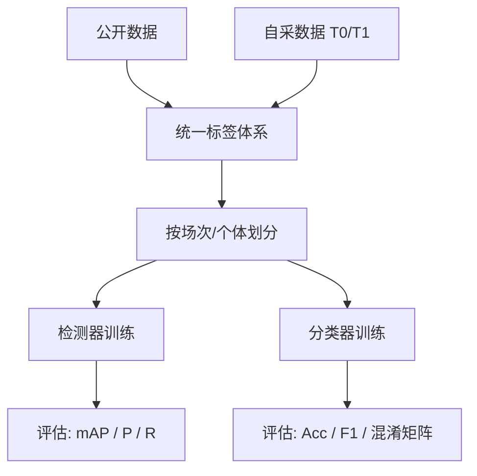

# 水果成熟度检测与分拣 · 开题报告 PPT 准备文档

> **项目**：基于单目 RGB 的水果成熟度检测与分拣  
> **团队**：6 人 · **周期**：4 周 · **Demo**：手机俯拍预录视频  
> **文档版本**：v1 · 2026-10-18  
> **用途**：组内分工、逐页制作、讲稿与答辩准备  
> **假设**：开题汇报 8–10 分钟，问答 3–5 分钟；如实际时长不同，按第 1.2 节裁剪。

---

## 0. 使用说明与统一口径

### 0.1 这份文档怎么用

1. 先读第 0、1、2 节，全组统一说法、页面结构和视觉规范。
2. 每人认领第 3 节里自己负责的页面，按“页面文字 / 数据 / 图片 / 讲稿 / 制作任务”逐项完成。
3. 用第 4 节素材清单催进度，用第 7 节排练清单做最终检查。
4. 开题阶段只放**计划指标、预实验和示意图**，不要放还没做出来的“最终结果”。

### 0.2 统一口径（全组必须一致）

| 项目 | 统一说法 | 不要这样说 |
|---|---|---|
| 题目 | 基于单目 RGB 的水果成熟度检测与分拣 | “水果成熟度 AI 检测系统”（太大） |
| 成熟度 | **外观成熟度**（颜色、表皮、形状） | “糖度/硬度检测” |
| 范围 | 香蕉 + 番茄；4 种状态；桌面场景 | “适用于所有水果” |
| 系统 | 轻量分拣**原型**（软件模拟） | “全自动产线” |
| 数据 | 公开数据 + 自采测试集（T0）；是否扩到 T1 由 G1 决定 | “完全自采”或“完全公开”（未定前不要说死） |
| 创新 | 完整链路 + 传统/深度对照 + 域适配量化（若 T1） | “首创 / 填补空白 / SOTA” |
| 指标 | 统一写“目标值（草案）” | 把目标值说成已完成结果 |

### 0.3 已知条件与假设

- 4 周、6 人、本机 RTX 4060 Laptop 8GB，可本地训练 YOLO。
- 数据策略：第 1 周按 **T0** 启动（公开数据 + 50–100 张自采独立测试集）；第 1 周末 G1 决定是否升 **T1**（再加 300–500 张训练/微调图）。
- Demo 主线：手机俯拍预录视频；硬件传送带/舵机不作为主线。
- 开题 PPT 按 13 页主页面 + 5 页备用页准备。

### 0.4 待确认事项（开题前必须问清）

- [ ] 老师是否**强制要求自采数据**？
- [ ] 是否要求**实物演示/硬件分拣**？
- [ ] 是否指定开题模板、页数、时长？
- [ ] 报告/答辩的语言与格式要求？
- [ ] 提交/答辩的准确日期？
- [ ] 公开数据集的使用许可与引用要求？

> 如果老师强制要求自采，直接把数据策略锁定为 T1，第 3 节第 6 页的文字按“T1”版本写，其余不变。

---

## 1. PPT 总览

### 1.1 页面结构与时间

| 页码 | 标题 | 这一页的任务 | 时长 | 负责人 |
|---|---|---|---|---|
| 1 | 封面 | 题目、团队、一句话定位 | 0:20 | P5 |
| 2 | 为什么做成熟度分拣 | 用产业痛点建立必要性 | 0:55 | P6 |
| 3 | 现有做法与我们的位置 | 三条路线 + 差异化定位 | 0:55 | P6 |
| 4 | 问题定义与项目范围 | 明确做什么、不做什么 | 0:45 | P1 |
| 5 | 总体技术路线 | 一页看懂系统链路 | 0:55 | P5 |
| 6 | 数据方案 | 数据从哪来、多少、怎么分 | 0:55 | P1 |
| 7 | 标签体系与标注规范 | 四状态怎么定义、怎么保证一致 | 0:45 | P2 |
| 8 | 检测与分类模型 | 方法、理由、对照基线 | 1:05 | P3/P4 |
| 9 | 分拣系统与 Demo | 系统怎么跑、演示长什么样 | 0:45 | P5 |
| 10 | 实验设计与评价指标 | 怎么证明有效 | 0:45 | P6 |
| 11 | 进度、分工与闸门 | 4 周怎么排、谁负责 | 0:35 | P6 |
| 12 | 风险与应对 | 提前暴露风险，给出预案 | 0:25 | P1 |
| 13 | 预期成果与结束 | 交付物 + 一句话收束 | 0:25 | P6 |

**合计约 9:30–10:00。** 每页讲稿按 3.5–4 字/秒估算，正式排练时以秒表为准。

### 1.2 不同时长的裁剪方案

| 时长 | 保留页面 | 处理方式 |
|---|---|---|
| **5 分钟** | 1、2、4、5、6、8、9、13 | 3/7/10/11/12 合并成两页或只口头带过 |
| **8 分钟** | 1–10、13 | 11/12 各压到 15 秒 |
| **10 分钟** | 全部 13 页 | 按上表时间 |
| **15 分钟** | 全部 + 备用页 B1–B4 | 数据、实验、模型细节展开 |

> 不要为了凑时长加页；宁可把一页讲透。

---

## 2. 制作规范

### 2.1 视觉规范

- 比例 **16:9（1920×1080）**。
- 字体：标题用思源黑体/微软雅黑 Bold，正文用思源黑体/微软雅黑 Regular。
- 字号：大标题 36–44pt，页面标题 30–36pt，正文 20–24pt，图注 14–16pt。
- 配色：**2 个主色 + 1 个强调色**。建议深绿（水果/农业）+ 暖黄（成熟）+ 深灰（文字），不要用渐变大背景。
- 每页只放一个核心结论；标题写成一句话，不写“研究背景”这种标签。
- 图表优先于文字；能用一张图说清的，不放 5 行字。
- 图片统一圆角/描边风格；不要用带水印的新闻图；引用外部图片必须标注来源。

### 2.2 文字规范

- 每页 **≤ 5 条**，每条 **≤ 25 个汉字**。
- 不写整段话；讲稿放在备注里，不放在页面上。
- 数字统一保留同一种精度（如 14%、25.4%、0.5 s）。
- 同一概念全篇用同一个词：统一用“四状态”“两阶段”“自采测试集”。

### 2.3 图片与引用规范

- 示意图统一用 draw.io / PowerPoint 重画，不直接截论文或新闻图。
- 数据集样例图从公开数据集取，页脚标注数据集名称与链接。
- 自己拍的照片优先；拍摄时避免露出品牌、人脸、无关杂物。
- 所有外部数据在页脚或备用页给出处，正文用 [1][2] 编号。

---

## 3. 逐页制作

### 第 1 页｜封面（0:20）

**这一页要回答的问题**：你们是谁、做什么、边界是什么。

**页面文字（可直接用）**

- 主标题：**基于单目 RGB 的水果成熟度检测与分拣**
- 副标题：YOLO 检测 + 成熟度分类 + 轻量分拣演示
- 一行定位：**2 种水果 × 4 种外观状态 × 1 条完整链路**
- 底部：第 X 组｜组员：……｜指导教师：……｜2026 年 X 月

**图片/素材**

- 一张自己拍的香蕉/番茄俯拍图，或简洁的深绿底 + 白色标题。
- 不要用复杂模板、不要放校徽以外的装饰。

**讲稿（约 20 秒）**

> 各位老师好，我们是第 X 组，题目是《基于单目 RGB 的水果成熟度检测与分拣》。我们要做的是：用普通摄像头识别香蕉和番茄的四种外观状态，并在视频里模拟一条分拣线。下面从背景、现状、方案和计划四个方面汇报。

**制作任务**

- [ ] 定稿题目与副标题（全组确认）
- [ ] 收集组员姓名、学号、指导教师
- [ ] 选主视觉图（自己拍或纯色底）
- [ ] 建立统一 PPT 模板（字体、配色、页脚）

**备注**：开题阶段不要写“系统已完成”，用“拟实现/将交付”。

---

### 第 2 页｜为什么做成熟度分拣（0:55）

**这一页要回答的问题**：这件事为什么值得做。

**页面文字（可直接用）**

- 成熟度决定**用途、价格、货架期**
- 果蔬采后损耗高：FAO 估计约 **1/4** 在生产到零售环节损耗
- 人工分选：**慢、主观、不可追溯**
- 机器视觉：**非接触、一致、可记录**

**数据/数字**

- FAO 2019：全球约 **14%** 的粮食在收获到零售之间损耗（全品类，不是果蔬单独数字）。
- FAO 2023：果蔬生产到零售环节损耗约 **25.4%**（**待核对**最新口径）。
- 早期研究估计果蔬全链条损耗可达 **40–50%**（只放讲稿，不上页面）。

**图片/图表**

- 左侧：3 个数字卡片（14%、25.4%、4 状态）。
- 右侧：一张水果分拣/果园照片（自己拍或免费图库），或一张简单的“人工 vs 机器”对比图。
- 页脚：数据来源 [1][2]。

**讲稿（约 55 秒）**

> 先看为什么做。成熟度决定水果的用途、价格和货架期；但果蔬采后损耗很高，FAO 估计约四分之一的果蔬在生产到零售环节损耗。人工分选又慢、又主观、不可追溯。机器视觉可以非接触、连续、可记录地完成分级，这是我们的切入点。

**制作任务**

- [ ] 找 1 张水果/分拣场景图（可用自己拍的照片）
- [ ] 做 2–3 个数字卡片
- [ ] 核对 FAO 两个数字的口径，页脚写清“全品类/果蔬”
- [ ] 确认不在页面上放“40–50%”这种容易引起争议的数字

**备注**：不要把“14%”说成“果蔬损耗 14%”；两个数字口径不同。

---

### 第 3 页｜现有做法与我们的位置（0:55）

**这一页要回答的问题**：别人做到哪一步，你们补的是哪块。

**页面文字（可直接用）**

三列对比：

| 路线 | 做法 | 优点 | 局限 |
|---|---|---|---|
| 传统视觉 | 颜色/纹理/光谱 + 阈值/SVM | 可解释、成本低 | 怕光照、泛化弱 |
| 深度学习 | YOLO/CNN 检测与分类 | 精度高、可端到端 | 依赖数据、调参多 |
| 商用系统 | 近红外/多光谱 + 多传感器 | 0.5 s 测 12 项指标 | 成本高、体积大 |

底部一行定位：**我们做低成本单目 RGB + 完整链路的原型验证，不追求产线指标。**

**数据/数字**

- 商用案例（甘肃庆阳苹果分选线）：8 通道、360° 光学成像 + 近红外，0.5 秒检测糖度、色泽、果径、瑕疵、成熟度等 12 项指标，年加工约 4000 吨。[8]
- 综述指出：实验室精度与商用可靠性之间仍有差距，跨品种/跨批次泛化是主要瓶颈。[5]

**图片/图表**

- 三列对比表（用 PPT 表格或三张卡片）。
- 右侧一张**自己画的**商用线示意图：传送带 → 相机/近红外 → 分选机构。不要直接截新闻图。

**讲稿（约 55 秒）**

> 现有做法有三类。传统视觉用颜色、纹理加分类器，可解释但怕光照；深度学习用 CNN 和 YOLO，精度高但依赖数据；商用线用近红外和多传感器，0.5 秒能测 12 项指标，但成本高、体积大。我们的定位是低成本单目 RGB 的完整链路原型，不追求产线指标。

**制作任务**

- [ ] 做三列对比表
- [ ] 画商用线示意图（draw.io/PPT）
- [ ] 核对庆阳案例的 4 个数字
- [ ] 准备一句“我们不做什么”的过渡

**备注**：不要贬低商用线；承认它更强，反而显得定位清楚。

---

### 第 4 页｜问题定义与项目范围（0:45）

**这一页要回答的问题**：你们到底解决什么问题，边界在哪。

**页面文字（可直接用）**

- **输入**：单目 RGB 图像 / 视频
- **输出**：水果种类 + 边界框 + 4 种状态
- **约束**：2 种水果（香蕉、番茄）、桌面场景、离线/近实时
- **不做**：内部品质（糖度/硬度）、多品种通用、产线级速度、硬件分拣

**图片/图表**

- 左侧“做什么”，右侧“不做什么”，中间一条竖线。
- 或者用 2×2 矩阵：输入/输出/约束/不做。

**讲稿（约 45 秒）**

> 我们把问题限定清楚：输入是单目 RGB 图像或视频，输出是种类、边界框和四种状态；只做香蕉和番茄，只做外观成熟度，不测糖度硬度，不做多品种通用，也不做硬件分拣。范围收窄，是为了四周内交付一个完整、可复现的系统。

**制作任务**

- [ ] 与全组确认“不做”清单，避免后面加需求
- [ ] 做“做什么/不做什么”两栏
- [ ] 在讲稿里准备一句：为什么不做内部品质

**备注**：这页是开题答辩的“防守页”，范围越清楚，后面被问“你们怎么不做 X”时越好回答。

---

### 第 5 页｜总体技术路线（0:55）

**这一页要回答的问题**：系统由哪些部分组成，数据怎么流动。

**页面文字（可直接用）**

- 离线：公开数据 → 统一标签 → 划分 → 训练检测器 / 分类器
- 在线：视频 → 检测 → ROI 裁剪 → 分类 → 跟踪 → 分拣线 → 计数/日志
- 对照：HSV 颜色矩 + GLCM/LBP + SVM 传统基线

**图片/图表**

主图（建议用 draw.io 重画）：

离线训练分支：

**讲稿（约 55 秒）**

> 技术路线是两阶段：YOLO 先检测种类和位置，裁剪出果实区域后送分类器判成熟度，再用跟踪和虚拟分拣线做计数。下面这条是传统特征基线，用来做对照。两阶段的好处是分类数据可以复用，小样本下更稳，也方便做消融。

**制作任务**

- [ ] 用 draw.io/PPT 重画主图，控制在 8 个框以内
- [ ] 每个箭头写动词：检测、裁剪、分类、跟踪、触发、计数
- [ ] 离线分支放在角落，不要抢主线
- [ ] 导出 PNG 备用（防止现场 Mermaid 渲染失败）

**备注**：图不要塞满模型细节；细节放第 8 页。

---

### 第 6 页｜数据方案（0:55）

**这一页要回答的问题**：数据从哪来、多少、怎么划分、怎么保证不泄漏。

**页面文字（可直接用）**

- 公开数据：负责**量**和预训练
- 自采数据：负责**真实场景**
- T0：公开数据 + **50–100 张独立测试集**
- T1（G1 决定）：再加 **300–500 张**训练/微调图
- 划分：按**场次/个体**，7 : 1.5 : 1.5，测试集冻结

**数据/数字**

| 数据集 | 规模 | 内容 | 用途 |
|---|---|---|---|
| FreshCheck | 20,704 张 | 香蕉 13,478 + 番茄 7,226，4 状态 | 分类预训练/主训练 |
| Roboflow Fruit Ripening | 7,546 张 | 6 类，带检测框 | 检测预训练/类别映射 |
| 草莓成熟度 | 566–1,132 张 | 3 类，YOLO 格式 | 可选第三物种 |
| 自采 T0 | 50–100 张 | 独立测试集 | 测域差距 |
| 自采 T1 | 300–500 张 | 2 物种 × 4 状态 | 微调/验证 |
| Demo 视频 | 3–5 段 | 15–20 秒/段 | 演示与端到端评估 |

> 数字以下载后实际统计为准；FreshCheck 的结构（分类目录还是检测框）必须在页脚注明。

**图片/图表**

- 左侧数据表；右侧 3×3 样例九宫格（公开数据 + 自采照片）。
- 样例图下标注来源。

**讲稿（约 55 秒）**

> 数据分两部分：公开数据负责量和预训练，FreshCheck 有约两万张香蕉和番茄的四状态图；自采数据负责真实场景，先做 50 到 100 张独立测试集，第 1 周末再决定是否扩到 300 到 500 张做微调。划分按场次和个体，避免同一颗水果跨训练和测试集。

**制作任务**

- [ ] 下载并统计 FreshCheck 的实际类别与数量
- [ ] 确认它是分类目录还是检测标注
- [ ] 截 9 张样例图做九宫格
- [ ] 写清数据来源、许可、页脚链接
- [ ] 与 P2 确认自采数量与拍摄计划

**备注**：开题时自采数据可能还没拍完，页面写“计划采集”，不要写“已采集 500 张”。

---

### 第 7 页｜标签体系与标注规范（0:45）

**这一页要回答的问题**：四种状态怎么定义，边界怎么判，怎么保证标注一致。

**页面文字（可直接用）**

| 状态 | 香蕉 | 番茄 | 判据 |
|---|---|---|---|
| 未熟 unripe | 全绿、硬 | 青绿、硬 | 无明显转色 |
| 成熟 ripe | 黄底、少量斑点 | 红色均匀、适度软 | 达到目标色 |
| 过熟 overripe | 大面积褐斑、过软 | 深红、起皱、过软 | 颜色过深/质地过软 |
| 损坏 spoiled | 霉斑、渗液、破皮 | 霉斑、裂口、渗液 | 可见腐烂/机械损伤 |

- 边界规则：过熟看颜色/质地，损坏看霉斑/渗液/裂口
- 遮挡超过一半不标；一颗水果一个状态
- 一致性：两人各标 50 张，简单一致率目标 ≥ 80%

**图片/图表**

- 2 行 × 4 列参考图（香蕉/番茄各一行，四状态各一列），每格 2–3 张。
- 用自己拍的照片；拍之前先写好判定标准。

**讲稿（约 45 秒）**

> 四种状态的定义写在规范里：未熟、成熟、过熟、损坏。最容易混的是过熟和损坏，我们用霉斑、渗液、明显破损作为损坏的判据；遮挡超过一半不标。每个状态每种水果配三张参考图，两个人先各标 50 张算一致性。

**制作任务**

- [ ] 写一页《标注规范 v1》（判定标准 + 反例）
- [ ] 拍/选 8–24 张参考图，做 contact sheet
- [ ] 两人各标 50 张，算一致率
- [ ] 把不一致的类别合并或重定义

**备注**：这页是老师最可能追问的地方；准备 1–2 个边界案例（过熟 vs 损坏）在备用页 B2。

---

### 第 8 页｜检测与分类模型（1:05）

**这一页要回答的问题**：用什么模型、为什么、怎么训、怎么评。

**页面文字（可直接用）**

- 检测：YOLO11n 起步，2 类，640，100–150 epochs
- 分类：YOLO11n-cls / ResNet18，4 类，224，60 epochs
- 基线：HSV 颜色矩 + GLCM/LBP + SVM
- 增强：翻转、缩放、轻度 HSV；**不做大幅色相抖动**
- 评估：mAP50 / mAP50-95；Acc / Macro-F1 / 混淆矩阵

**数据/数字**

| 模型 | 输入 | 类别 | 关键设置 |
|---|---|---|---|
| YOLO11n（检测） | 640×640 | banana / tomato | batch 16，100–150 epochs |
| YOLO11n-cls / ResNet18 | 224×224 | 4 状态 | 60 epochs，迁移学习 |
| HSV+GLCM+LBP+SVM | ROI 裁剪 | 4 状态 | 传统特征对照 |

**图片/图表**

- 左侧两阶段流程图（检测框 → 裁剪 → 分类）。
- 右侧一张超参表 + 一句“为什么两阶段”。

**讲稿（约 65 秒）**

> 检测用 YOLO11n 起步，两类，640 分辨率；分类用轻量分类网络，四类，224。传统基线是 HSV 颜色矩加 GLCM 纹理再加 SVM。训练时注意别做大幅色相抖动，因为颜色就是成熟度线索。评估看 mAP、宏 F1 和混淆矩阵，重点看过熟和损坏的互错。

**制作任务**

- [ ] P3 填检测超参表
- [ ] P4 填分类/传统基线超参表
- [ ] 画两阶段流程图
- [ ] 准备一句“为什么不用端到端”的回答（见 Q&A）

**备注**：不要在这页堆 loss、学习率、优化器细节；放备用页 B3。

---

### 第 9 页｜分拣系统与 Demo（0:45）

**这一页要回答的问题**：系统怎么跑起来，演示是什么样。

**页面文字（可直接用）**

- 管线：检测 → 裁剪 → 分类 → ByteTrack → 虚拟分拣线 → 4 个料筐
- 去重：每个 track_id 只触发一次
- 输出：画面标注 + 计数 + CSV 日志
- Demo：手机俯拍、手推水果、1080p 预录视频
- 硬件舵机：只作为加分项，不进主线

**图片/图表**

- 一张 UI mockup：画面框 + 标签 + 右侧四个料筐 + FPS。
- 一张 3 帧 storyboard：水果进入 → 越线 → 落入料筐。
- 开题阶段用 mockup，标注“示意图”；不要 P 假结果。

**讲稿（约 45 秒）**

> 系统部分：视频进来，检测、裁剪、分类，再用 ByteTrack 给每个水果一个 ID，越过虚拟分拣线时只触发一次，分到四个筐里并写日志。Demo 用手机俯拍、手推水果的预录视频，稳定可重录；实物舵机只作为加分项，不进主线。

**制作任务**

- [ ] P5 画 UI mockup
- [ ] 画 3 帧 storyboard
- [ ] 确定分拣线位置（画面 60% 处）和四个筐的颜色
- [ ] 准备 CSV 日志字段：帧号、track_id、种类、状态、置信度

**备注**：不要把 Demo 说成“实时产线”；说“预录视频上的近实时推理”。

---

### 第 10 页｜实验设计与评价指标（0:45）

**这一页要回答的问题**：怎么证明系统有效，和谁比。

**页面文字（可直接用）**

| 实验 | 变量 | 指标 |
|---|---|---|
| 检测模型对比 | YOLO11n vs 11s | mAP50 / mAP50-95 / FPS |
| 分类模型对比 | CNN vs HSV+GLCM+SVM | Acc / Macro-F1 |
| 结构对比 | 两阶段 vs 单模型 8 类 | mAP / Acc / 延迟 |
| 消融 | 跟踪开/关、增强开/关 | 重复计数率 / Acc |
| 域适配 | 公开数据 vs +自采微调 | 自采测试集 Acc（T1） |
| 端到端 | 完整管线 | 分拣准确率 / 漏检率 / FPS |

- 测试集冻结，不参与调参
- 目标值（草案）：检测 mAP50 ≥ 0.85；分类 Acc ≥ 0.85；端到端分拣准确率 ≥ 0.85

**图片/图表**

- 一张实验矩阵表；一张“指标定义”小卡。
- 开题阶段只放实验设计，不放结果；如果有预实验，标注“预实验”。

**讲稿（约 45 秒）**

> 实验分三块：模型对比、模块消融、端到端指标。模型对比包括 n 和 s、两阶段和单模型八类、CNN 和传统特征；消融包括跟踪开关和数据增强；端到端看分拣准确率、漏检率、重复计数和 FPS。测试集冻结后不参与调参。

**制作任务**

- [ ] P6 做实验矩阵表
- [ ] 定义每个指标的公式/口径
- [ ] 确认目标值是“草案”，不是承诺
- [ ] 准备一句“如果指标达不到怎么办”（G2 回退）

**备注**：不要把 mAP 和 Acc 混在一页却不解释；用一句话说明两者分别评什么。

---

### 第 11 页｜进度、分工与闸门（0:35）

**这一页要回答的问题**：4 周怎么排，谁负责，卡点在哪。

**页面文字（可直接用）**

- W1 数据与基线；W2 检测与分类；W3 集成与录像；W4 实验与交付
- G1：数据冻结；G2：模型可用；G3：Demo 可跑
- 6 人：数据 2、检测 1、分类/传统 1、集成 1、评测/文档 1

**图片/图表**

甘特图（4 周 × 5 条泳道）：

| 周 | 数据 | 模型 | 系统 | 评测/文档 |
|---|---|---|---|---|
| W1 | 采集/标注/划分 | 环境+基线 | 骨架 | 指标脚本 |
| W2 | 补样/冻结 | 检测+分类 | 管线 | 评估 |
| W3 | 困难样本 | 调优 | 集成+录像 | 消融 |
| W4 | 冻结 | 最终权重 | 备用视频 | 报告/PPT |

底部三个闸门：G1 第 1 周末、G2 第 2 周末、G3 第 3 周末。

**讲稿（约 35 秒）**

> 进度四周：第一周数据和基线，第二周检测和分类，第三周集成和录像，第四周实验和交付。三个闸门分别在第 1、2、3 周末，过不了就按预案缩范围。六个人分工是数据两人、检测一人、分类一人、集成一人、评测文档一人。

**制作任务**

- [ ] P6 做甘特图（Excel/PPT/draw.io）
- [ ] 标出三个闸门和回退方案
- [ ] 与全组确认分工，写进页脚

**备注**：开题时老师最关心“4 周做不做得完”；这页要显得可信，不要排得太满。

---

### 第 12 页｜风险与应对（0:25）

**这一页要回答的问题**：你们知道哪里会翻车，准备了什么预案。

**页面文字（可直接用）**

| 风险 | 影响 | 应对 |
|---|---|---|
| 数据采集拖延 | 高 | G1 回退到 T0/公开数据 |
| 类别边界主观 | 高 | 标注规范 + 双人一致性 |
| 域差距 | 高 | 自采测试集 + 微调 + 颜色归一化 |
| 模型效果不佳 | 中 | 单物种/3 状态/更小模型 |
| 现场演示翻车 | 中 | 预录视频 + 备用文件 |
| 进度延期 | 中 | 每周闸门 + 第 4 周缓冲 |

**图片/图表**

- 2×3 风险卡片，或一张风险矩阵（概率 × 影响）。

**讲稿（约 25 秒）**

> 主要风险是数据、标签和域差距。应对分别是闸门回退、标注规范和自采测试集；演示风险用预录视频兜底，我们不把宝押在现场灯光上。

**制作任务**

- [ ] P1 做风险表
- [ ] 给每个风险写触发条件和回退动作
- [ ] 确认“演示用预录视频”是全组共识

**备注**：这页不要念表；挑 2 个最重要的风险讲。

---

### 第 13 页｜预期成果与结束（0:25）

**这一页要回答的问题**：最后交付什么，一句话收束。

**页面文字（可直接用）**

- 数据集 v1 + 数据说明（datasheet）
- 检测器 + 分类器权重
- 端到端分拣 Demo + 30–60 秒视频
- 实验报告 + 代码仓库（README 可复现）
- 一句话：**做一个边界清楚、可复现、能讲明白的原型**

**图片/图表**

- 5 个交付物卡片，图标用简单线性图标或纯文字，不要用 emoji。
- 结束页：谢谢 + 请提问。

**讲稿（约 25 秒）**

> 预期交付包括数据集和说明、两个模型权重、端到端 Demo 和视频、实验报告和代码仓库。我们的目标是做一个边界清楚、可复现、能讲明白的原型，而不是宣称超过商用线。谢谢，请老师提问。

**制作任务**

- [ ] P6 列交付物清单
- [ ] 做结束页
- [ ] 准备致谢与提问引导

**备注**：最后一句要落在“边界清楚”，不要喊口号。

---

### 备用页（不占正式时间，放在最后）

| 编号 | 内容 | 用途 |
|---|---|---|
| B1 | 数据集详细对比（规模、类别、许可、结构） | 回答“数据从哪来” |
| B2 | 过熟 vs 损坏的边界案例图 | 回答“怎么定义” |
| B3 | 两阶段 vs 单模型 8 类的对比 | 回答“为什么两阶段” |
| B4 | 训练超参、增强策略、消融清单 | 回答“怎么训” |
| B5 | 参考文献 | 回答“依据是什么” |
| B6 | Q&A 速查表（本文件第 6 节） | 答辩时自己看 |

---

## 4. 素材总清单

| # | 素材 | 用在哪页 | 形式 | 来源/制作 | 负责人 | 截止 |
|---|---|---|---|---|---|---|
| 1 | 主视觉图 | 1 | 图片 | 自己拍/纯色底 | P5 | D2 |
| 2 | 组员与导师信息 | 1 | 文字 | 群里收集 | P1 | D2 |
| 3 | 背景数字卡（14%、25.4%） | 2 | 图形 | PPT 制作 | P6 | D3 |
| 4 | 水果/分拣场景图 | 2 | 图片 | 自己拍/免费图库 | P5 | D3 |
| 5 | 商用线示意图 | 3 | 示意图 | draw.io 重画 | P5 | D4 |
| 6 | 三列对比表 | 3 | 表格 | PPT | P6 | D4 |
| 7 | 技术路线主图 | 5 | 示意图 | draw.io/PPT | P5 | D4 |
| 8 | 数据表 + 样例九宫格 | 6 | 表格+图片 | 数据集截图 + 自采 | P1 | D5 |
| 9 | 四状态参考图 contact sheet | 7 | 图片 | 自己拍 | P2 | D5 |
| 10 | 模型超参表 | 8 | 表格 | P3/P4 填写 | P3/P4 | D5 |
| 11 | UI mockup + 3 帧 storyboard | 9 | 示意图 | PPT/Figma | P5 | D6 |
| 12 | 实验矩阵表 | 10 | 表格 | PPT | P6 | D5 |
| 13 | 甘特图 + 分工表 | 11 | 图表 | Excel/draw.io | P6 | D5 |
| 14 | 风险表 | 12 | 表格 | PPT | P1 | D5 |
| 15 | 交付物清单 | 13 | 卡片 | PPT | P6 | D6 |
| 16 | 参考文献页 | B5 | 文字 | 统一格式 | P6 | D6 |

> D1 = 第 1 天。开题如果安排在更早，按比例压缩，先保证 1、4、5、6、8、9、13 七页。

---

## 5. 数据与事实附录

### 5.1 公开数据集

| 数据集 | 规模 | 类别/内容 | 结构 | 用途 | 备注 |
|---|---|---|---|---|---|
| FreshCheck（Kaggle） | 20,704 张 | 香蕉 13,478、番茄 7,226；4 阶段（unripe/ripe/overripe/spoiled） | 80/10/10，YOLO-ready 目录 | 分类主训练 | 下载后确认是分类目录还是检测框 |
| Fruit Ripening Process（Roboflow） | 7,546 张 | 6 类（freshripe/freshunripe/overripe/ripe/rotten/unripe） | 检测框 | 检测预训练/类别映射 | 类别有重叠，需清洗 |
| Multi-Class Strawberry（Kaggle） | 566–1,132 张 | Fullripe/Semiripe/Unripe | YOLO 检测格式 | 可选第三物种 | 不在主线 |
| 自采 T0 | 50–100 张 | 2 物种 × 4 状态 | 图片 + 类别 | 独立测试集 | 必须与训练数据不同场次 |
| 自采 T1 | 300–500 张 | 2 物种 × 4 状态 | 图片 + 框 + 类别 | 微调/验证 | G1 决定 |

### 5.2 四状态定义（标注规范 v1 草案）

| 状态 | 通用判据 | 香蕉示例 | 番茄示例 | 反例/边界 |
|---|---|---|---|---|
| unripe | 无转色、质地硬 | 全绿 | 青绿 | 局部转色算 ripe 还是 unripe？以 >50% 面积为准 |
| ripe | 达到目标色、适度软 | 黄底、少量斑点 | 红色均匀 | 香蕉少量褐斑仍算 ripe |
| overripe | 颜色过深/起皱/过软 | 大面积褐斑 | 深红、起皱 | 与 spoiled 的边界：无霉斑/渗液则算 overripe |
| spoiled | 霉斑、渗液、裂口、明显腐烂 | 霉变/破皮 | 霉斑/裂口 | 机械损伤也算 spoiled，需在报告里说明 |

**标注规则**

- 一颗水果一个状态；多果图片逐果标框。
- 遮挡 > 50% 不标；严重失焦不标。
- 同一颗水果的所有照片必须落在同一数据划分。
- 两人各标 50 张重叠样本，简单一致率目标 ≥ 80%；低于 70% 的类别重新定义。

### 5.3 指标口径（草案）

| 任务 | 指标 | 定义 | 目标 |
|---|---|---|---|
| 检测 | mAP@0.5 | IoU≥0.5 的平均精度 | ≥ 0.85 |
| 检测 | mAP@0.5:0.95 | IoU 0.5–0.95 平均 | ≥ 0.65 |
| 分类 | Accuracy | 正确数/总数 | ≥ 0.85 |
| 分类 | Macro-F1 | 四类 F1 的宏平均 | ≥ 0.80 |
| 分类 | 每类 Recall | 每类召回率 | 每类 ≥ 0.75 |
| 端到端 | 分拣准确率 | 正确落入对应筐/总触发 | ≥ 0.85 |
| 端到端 | 重复计数率 | 同一 track 重复触发/总触发 | < 2% |
| 端到端 | FPS | 端到端帧率 | ≥ 15（4060） |
| 端到端 | 延迟 | 采集→触发 p50/p95 | 记录，不设硬指标 |

> 以上是开题阶段的“目标值（草案）”，基线跑出来后按实际情况调整；报告中要区分“目标”和“实测”。

### 5.4 参考文献（建议 6–8 条）

1. FAO. *The State of Food and Agriculture 2019 / Food Loss Index*. https://openknowledge.fao.org/server/api/core/bitstreams/d640a51f-7b66-46a1-bfea-0eb5029a7b83/content/y5431e02.htm
2. FAO. 果蔬采后损耗相关数据（2023 口径，使用前核对）. https://openknowledge.fao.org/server/api/core/bitstreams/f689ccb6-2a62-4a46-9213-08e0681fd22c/content
3. FreshCheck: Fruit Ripeness Classification Dataset. Kaggle. https://www.kaggle.com/datasets/orofinadamola/freshcheck-fruit-ripeness-classification-dataset
4. Fruit Ripening Process. Roboflow Universe. https://universe.roboflow.com/divyansh-4vyra/fruit-ripening-process-lssyw
5. *Postharvest Fruit Grading Technologies and Equipment: A Review*. Foods, 2026. https://www.mdpi.com/2304-8158/15/18/3308
6. Ultralytics YOLO Documentation. https://docs.ultralytics.com/
7. COCO Dataset. https://cocodataset.org/
8. 庆阳苹果 AI 智慧分选线报道（2026-10）. https://qy.gansudaily.com.cn/system/2026/10/16/031445963.shtml
9. 机器视觉在水果表型特征分级应用的研究进展（2025）. 万方/知网.

### 5.5 需要核实的数字

- [ ] FreshCheck 的实际图片数、类别名、目录结构、许可证。
- [ ] Roboflow 数据集的许可证、类别定义、是否有重叠标签。
- [ ] FAO “25.4%” 的年份与口径（果蔬，生产到零售）。
- [ ] 庆阳案例的 8 通道、0.5 秒、12 项、4000 吨是否都来自同一篇报道。
- [ ] 课程对页数、时长、模板的要求。

> 开题 PPT 里凡是标了“约/据”的数字，页脚必须给出处；没核实的数字不要上页面，放讲稿里也要加“据…”。

---

## 6. 答辩 Q&A 预案

> 建议每人熟记与自己负责页面相关的 3–4 个问题；答辩时由对应负责人回答，其他人不抢话。

| # | 可能的问题 | 建议回答 |
|---|---|---|
| 1 | 为什么不做糖度/硬度？ | 单目 RGB 看不到内部品质，测糖度/硬度需要近红外或高光谱，成本和复杂度都高。我们明确限定“外观成熟度”，并在报告里写清局限。 |
| 2 | 商用分选线早就有了，你们创新在哪？ | 不宣称首创。我们的贡献是低成本单目 RGB 的完整链路、两阶段与传统特征的对照、以及公开数据到自采场景的域适配量化（若 T1）。 |
| 3 | 成熟度怎么定义？ | 四状态 + 参考图 + 边界规则；两人各标 50 张算一致性；不一致的类别合并或重定义。 |
| 4 | 数据从哪来？自采多少？ | 公开数据负责量和预训练；自采负责真实场景。第 1 周先做 50–100 张测试集，G1 决定是否扩到 300–500 张微调。 |
| 5 | 公开数据的许可证有问题吗？ | 用 Kaggle/Roboflow 公开数据，报告里引用来源和许可；课程用途；下载后核对 license，不再分发原始数据。 |
| 6 | 为什么两阶段，不端到端？ | 分类数据可复用、小样本更稳、模块化易消融；计划里会和单模型 8 类做对比，用数据说话。 |
| 7 | 类别不均衡怎么办？ | 补采、类别加权、合并稀有类；报告 per-class recall，不只看总体 accuracy。 |
| 8 | 换一种水果还能用吗？ | 检测器可以扩展新类；分类器需要重新标数据训练；本次不做多品种通用，这是范围之外。 |
| 9 | Demo 是实时吗？延迟多少？ | 主线用预录视频，可离线/近实时；目标 ≥15 FPS；报告 p50/p95 延迟，不夸大。 |
| 10 | 6 个人怎么分工？ | 数据 2、检测 1、分类/传统 1、集成 1、评测/文档 1；第 1 周全员标注。 |
| 11 | 模型效果不好怎么办？ | G2 回退：单物种、3 状态、更小模型；报告如实写指标和局限，不藏。 |
| 12 | 最大风险是什么？ | 数据和标签。用 G1 闸门、标注规范、自采测试集应对；演示用预录视频兜底。 |
| 13 | 为什么用 YOLO11n 而不是大模型？ | 4060 8GB、实时性、小数据；n vs s 做消融，按 FPS/精度取舍。 |
| 14 | 四周够吗？ | 三个闸门 + 第 4 周缓冲；范围已缩到 2 物种 × 4 状态 + 软件 Demo。 |
| 15 | 过熟和损坏怎么区分？ | 过熟看颜色过深/起皱/过软；损坏看霉斑/渗液/裂口/明显腐烂；边界样本双人复核，一致性低就合并。 |
| 16 | 为什么不用分割？ | 检测框足够支撑分拣原型；分割会显著增加标注成本；轮廓/分割可作为后续工作。 |

**回答原则**

- 不会的问题不要编：先确认问题，再说“这一点我们还没验证，计划在 X 阶段补”。
- 不要和老师争；把“局限”说清楚，比硬撑更加分。
- 所有数字和页面保持一致；不要现场改口径。

---

## 7. 排练与交付清单

### 7.1 排练

- [ ] 至少 3 次完整试讲：D-7、D-3、D-1。
- [ ] 用秒表计时，目标 9:30，硬上限 10:30。
- [ ] 每人只讲自己负责的页；切换时用一句话衔接。
- [ ] 不读 PPT；讲稿只留关键词。
- [ ] 找一个人扮演老师，问第 6 节的 5 个问题。

### 7.2 现场物料

- [ ] 16:9  PPT + PDF 备份
- [ ]  Demo 视频单独存一份（MP4，H.264，离线可播）
- [ ] 转接头（HDMI/Type-C）、翻页笔、充电器
- [ ] 提前到场测试投影比例、字体、视频声音
- [ ] 关闭通知、勿扰模式；准备激光笔

### 7.3 交付前检查

- [ ] 每页标题是一句话结论，不是标签。
- [ ] 每页 ≤ 5 条，每条 ≤ 25 字。
- [ ] 所有数字口径一致，页脚有出处。
- [ ] 没有“最终结果”冒充已完成；计划指标标注“目标/草案”。
- [ ] 图片无 watermarked 新闻图；外部图有引用。
- [ ] 备用页 B1–B6 齐全。
- [ ] 全组能脱稿讲清“做什么、不做什么、怎么做、四周怎么排”。

---

## 8. 分工与截止时间

> 按 10/19 为 D1；如果开题更早，整体前移，优先保证第 1、4、5、6、8、9、13 页。

| 角色 | 人 | 负责页面 | 主要任务 | 截止 |
|---|---|---|---|---|
| P1 数据负责人 | 1 | 4、6、12 | 公开数据核验、标签规范、划分、数据表、风险表 | D5 |
| P2 数据/标注 | 1 | 7（与 P1） | 自采拍摄、参考图、一致性抽查 | D5 |
| P3 检测 | 1 | 8（检测部分） | 超参表、两阶段流程图、检测指标口径 | D5 |
| P4 分类/传统 | 1 | 8（分类部分） | 分类超参、传统基线、混淆矩阵口径 | D5 |
| P5 集成/Demo | 1 | 1、5、9 | 主视觉、技术路线图、UI mockup、storyboard | D6 |
| P6 评测/文档 | 1 | 2、3、10、11、13 | 背景数据、研究现状、实验表、甘特图、统稿 | D6 |

**统稿节点**

- D4：各页文字初稿交 P6。
- D5：图片/图表交 P5；P6 合并第一版。
- D6：全组过一遍，删字、统一口径、补页脚。
- D7：第一次完整试讲 + G1 数据闸门。

---

## 9. 如果老师要求自采（T1 锁定版）

只需改三处，其余流程不变：

1. **第 6 页**：把“T0：50–100 张测试集；T1 待 G1”改成“T0 测试集 50–100 张 + T1 训练/微调 300–500 张，均在第 1 周完成”。
2. **第 10 页**：把“域适配”从“若 T1”改成“必做实验”。
3. **第 11 页**：第 1 周增加“拍摄 + 标注”任务，P2 的工作量上调，必要时 P4 支援标注。

同时把第 7 页的“一致性检查”从建议改成必做，并在报告里给出 κ 或简单一致率。

---

## 10. 一句话总结

**开题 PPT 的任务不是把系统讲完，而是让老师相信三件事：问题真实、范围可控、四周做得完。** 所有页面的文字、数据和图，都围绕这三件事服务。
